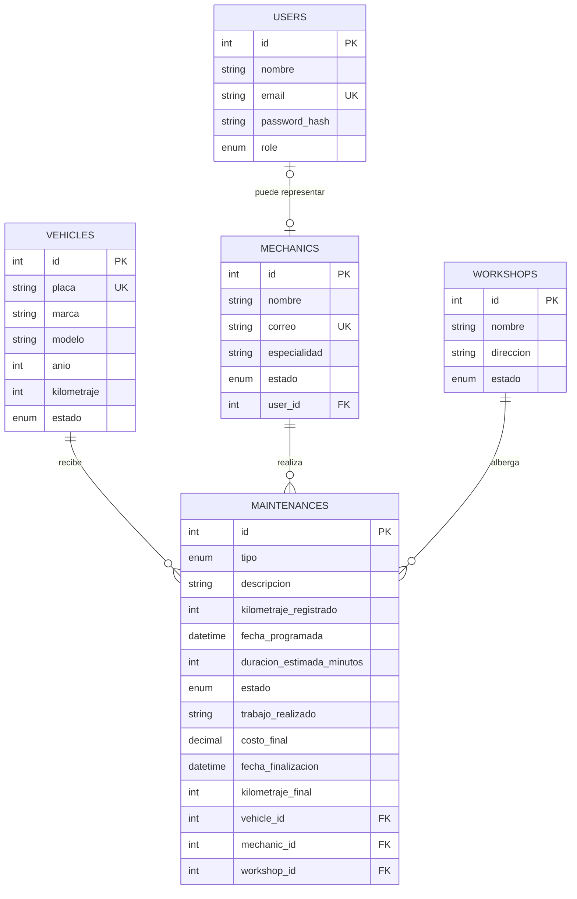

# Modelo relacional de FleetCore

## Decisiones del modelo

- Las placas, correos de usuario y correos de mecánico son únicos.
- La relación entre un usuario y un mecánico es opcional y uno a uno: permite
  registrar administradores sin ficha de mecánico y conservar un
  mecánico sin cuenta de acceso.
- Los mantenimientos conservan las relaciones históricas: las claves foráneas
  restringen borrar vehículos, mecánicos o talleres que ya tengan historial.
- `duracionEstimadaMinutos` permite calcular el intervalo programado de un
  mantenimiento y aplicar después la regla de no solapamiento de un mecánico.
- La información de cierre es nullable al crear el mantenimiento y será
  obligatoria únicamente cuando se cambie a `COMPLETED`.
